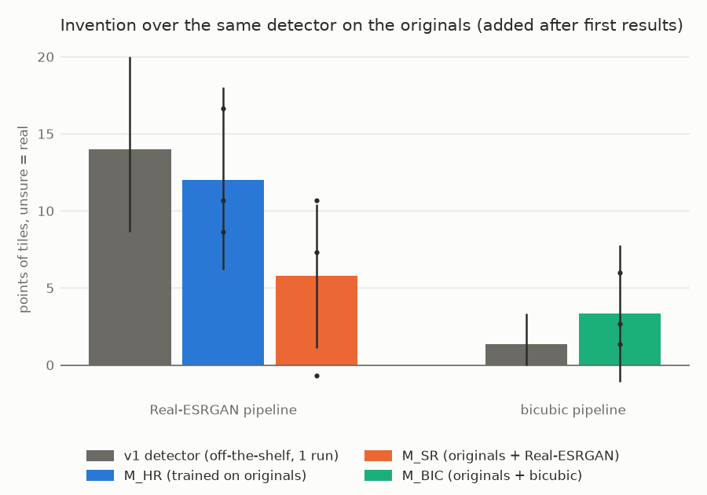
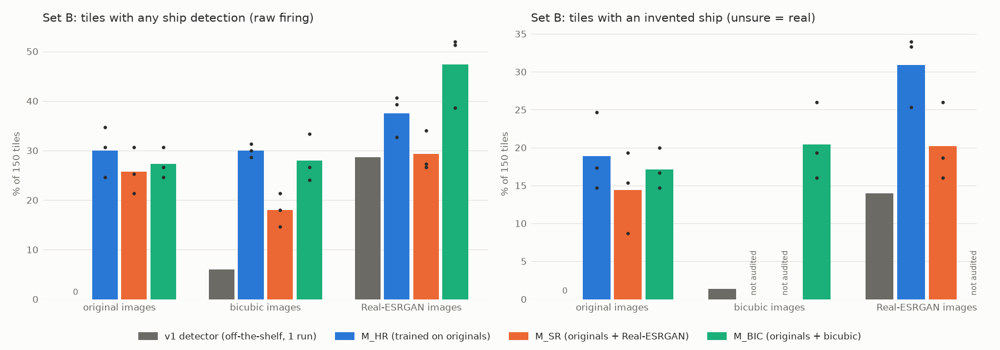
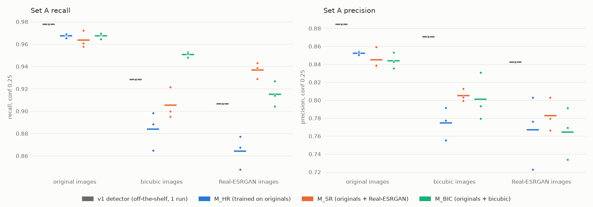
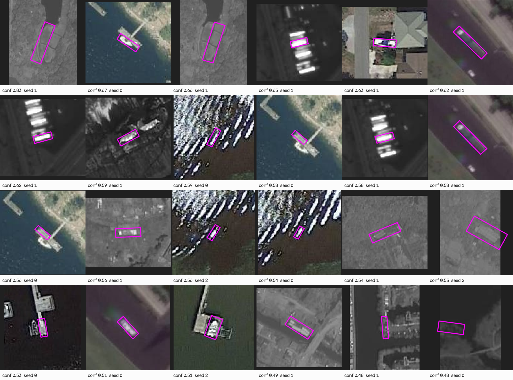

# v2 results: does training the detector on super-resolved images remove the invented ships?

Generated by `v2/scripts/11_summary.py` from the files in `v2/results/`; do not edit by hand. Everything marked *added after first results* was decided after the pre-registered numbers were seen and is not a pre-registered endpoint.

**TL;DR**

- **Q1, does training on SR help on SR images? Yes.** Invented ships on SR images fall from 30.9% to 20.2% of verified-empty tiles, and recall rises from 0.864 to 0.937.
- **Q2, under matched training does the SR pipeline still invent more than bicubic? No detectable gap:** 20.2% against 20.4% of tiles (95% CI −5.8 to +5.6 points); bicubic keeps slightly higher recall (0.951 against 0.937).
- **Caveat:** these small detectors also invent on 14.4–18.9% of the untouched originals; over that floor (an analysis added after first results), SR adds 5.8 points and bicubic 3.3, against 14.0 and 1.3 for v1's detector.
- **v1 correction:** a `max_det=300` cap understated v1's Set A recall by 2.4–2.7 points; Phase 0 found no SR bug.

## 1. What changed from v1, and why

v1 put Real-ESRGAN in front of an off-the-shelf DOTA detector (`yolov8s-obb`) that had never seen
super-resolved images. The detector reported ships on 28.7% of
the verified-empty Set B tiles after SR, against 6.0% after
bicubic upscaling, and the hand audit put invention at 14.0–16.0%
against 1.3–2.0%.

A reviewer made four points: the numbers looked worse than GAN super-resolution should produce; a
detector never trained on SR images mixes two effects, SR inventing detail and a detector meeting SR
artefacts for the first time; a small ship-only detector should be trained with and without SR
images and the experiment rerun; and v1 was a single run.

v2 responds point by point:

- **Phase 0** audits v1's SR pipeline for bugs (section 2).
- **Training set:** 900 tiles of 1024 px from 419 DOTA *train* images
  (600 with ships, 300 without, 150 of those hard negatives), split 90/10 by source image.
- **Three detectors**, YOLOv8n-OBB started from COCO weights, ship class only, the same number of
  gradient steps (10,150–10,200 batches of 8 per run), `last.pt` evaluated:

| Condition | trained on | epochs |
|---|---|---|
| M_HR | original | 100 |
| M_SR | original + Real-ESRGAN | 50 |
| M_BIC | original + bicubic | 50 |

- **Three seeds** per condition, nine runs.
- **Same test sets as v1:** Set A (3,380 labelled ships on 100 tiles) and Set B (150 tiles with no
  ship labels and no v1 detection on the original).
- **Pre-registered comparisons** (`PLAN.md`, written before any v2 result): C1, M_SR vs M_HR on SR
  images (the reviewer's question); C2, M_SR on SR vs M_BIC on bicubic (each pipeline with a detector
  trained on its own kind of image, the headline); C3, references. Primary endpoints: Set B invention
  at conf 0.25 in both unsure bands, and Set A recall at conf 0.25.
- **A new blind audit.** 6,177 Set B detections at conf 0.25 were pooled into
  1,332 regions; 139 inherited a v1 verdict, and
  1,193 became new crops of the original tile, plus 25 hidden
  repeats of v1 crops. The first 767 crops cover every cell the comparisons read;
  884 of 1,218 crops are labelled. Of the 767 priority crops,
  59 were judged a real vessel, 17 unsure and 691 not a ship.

## 2. Phase 0: the v1 SR pipeline

- **No SR implementation bug.** The official `realesrgan` inference code (`pre_pad=0`) on the CPU is
  bit-identical to v1's code on the CPU on 5 of 5 tiles; v1's Apple-GPU output differs from
  its CPU output only by rounding (89.8–92.2 dB PSNR). The degraded and bicubic images
  recompute exactly for 100/100 Set A and
  150/150 Set B tiles.
- **Greyscale tiles come out coloured.** 67 of 150 Set B and
  25 of 100 Set A tiles are greyscale; Real-ESRGAN writes colour into
  every one of them, as the official code does for 3-channel input. v1's SR firing was mostly on colour
  tiles (38/83 against 5/67 grey), and turning the SR
  output back to grey moves the v1 detector's SR firing from 28.7% to
  30.0%.
- **A real v1 bug, in the evaluation.** v1 called the detector with ultralytics' default `max_det=300`,
  and two dense harbour tiles hit that cap. That understated v1's Set A recall by 2.4–2.7
  points for every version at both thresholds; at conf 0.25 the SR-minus-bicubic recall gap moves from
  −0.020 to −0.022. v1's public README still shows the capped numbers; the corrected ones are
  here. v2 predicts with `max_det=1000`, and every image that reached it kept boxes down to conf
  0.042 or lower, so no count above 0.25 is affected.

| v1 detector, conf 0.25 | recall as v1 ran it (max_det 300) | recall, uncapped | change |
|---|---|---|---|
| original | 0.951 | 0.978 | +0.026 |
| bicubic | 0.901 | 0.928 | +0.027 |
| Real-ESRGAN | 0.881 | 0.907 | +0.026 |

- **Training images match the test pipeline across devices.** The bicubic and SR training images were
  made on the training GPU from the uploaded originals. A later run of the same notebook on the same
  image and GPU type found the original and degraded inputs bit-identical to the local ones for
  900 of 900 tiles, and its SR output within
  91.4–94.8 dB PSNR of local SR on 5 check tiles (rounding level).

## 3. Results

Every number is per seed, then mean ± SD over the three seeds (the v1 detector is one run). The
95% CI is a tile bootstrap of the seed-averaged difference (10,000 resamples, seed 0): it carries
tile-to-tile variation, the SD carries seed-to-seed variation. Primary endpoints are in bold. Set B
rates are the share of 150 tiles with at least one detection (firing) or at least one invented ship
(invention); "unsure = real" and "unsure = invented" are v1's two treatments of `unsure` verdicts.

### C1: on SR images, trained with SR (M_SR, A) vs never saw SR (M_HR, B)

| Metric (conf 0.25 unless noted) | M_SR on SR | M_HR on SR | difference | 95% CI | per seed (0, 1, 2) | same sign in all seeds |
|---|---|---|---|---|---|---|
| **Set B invention, unsure = real** (% of tiles) | 20.2 ± 5.2 | 30.9 ± 4.8 | −10.7 | −16.4 to −5.1 | +0.7, −17.3, −15.3 | no |
| **Set B invention, unsure = invented** (% of tiles) | 20.7 ± 4.7 | 32.7 ± 5.0 | −12.0 | −17.8 to −6.2 | −1.3, −16.0, −18.7 | yes |
| **Set A recall** | 0.937 ± 0.007 | 0.864 ± 0.015 | +0.073 | +0.033 to +0.119 | +0.066, +0.081, +0.071 | yes |
| invention, unsure = real, without P1751 | 20.4 ± 5.2 | 30.4 ± 4.9 | −10.1 | −15.7 to −4.5 | +1.3, −16.8, −14.8 | no |
| invention, unsure = real, conf 0.5 | 4.9 ± 3.0 | 9.6 ± 3.4 | −4.7 | −8.4 to −0.9 | +1.3, −11.3, −4.0 | no |
| Set B firing, raw | 29.3 ± 4.1 | 37.6 ± 4.3 | −8.2 | −13.8 to −2.7 | +1.3, −12.0, −14.0 | no |
| Set B firing beyond the original | 10.9 ± 2.7 | 15.8 ± 1.0 | −4.9 | −10.0 to +0.0 | −2.7, −3.3, −8.7 | yes |
| Set A precision | 0.783 ± 0.019 | 0.767 ± 0.041 | +0.016 | +0.001 to +0.033 | +0.044, +0.000, +0.003 | yes |
| Set A F1 | 0.853 ± 0.008 | 0.812 ± 0.017 | +0.041 | +0.018 to +0.067 | +0.053, +0.037, +0.032 | yes |
| Set A recall, conf 0.5 | 0.880 ± 0.015 | 0.777 ± 0.013 | +0.103 | +0.056 to +0.153 | +0.107, +0.101, +0.101 | yes |
| Set A AP50 | 0.935 ± 0.007 | 0.886 ± 0.006 | +0.049 | not bootstrapped | +0.058, +0.051, +0.038 | yes |

### C2: each pipeline with its own detector, M_SR on SR (A) vs M_BIC on bicubic (B), the headline

| Metric (conf 0.25 unless noted) | M_SR on SR | M_BIC on bicubic | difference | 95% CI | per seed (0, 1, 2) | same sign in all seeds |
|---|---|---|---|---|---|---|
| **Set B invention, unsure = real** (% of tiles) | 20.2 ± 5.2 | 20.4 ± 5.1 | −0.2 | −5.8 to +5.6 | +6.7, +0.0, −7.3 | no |
| **Set B invention, unsure = invented** (% of tiles) | 20.7 ± 4.7 | 20.7 ± 5.5 | +0.0 | −5.6 to +5.8 | +6.7, +1.3, −8.0 | no |
| **Set A recall** | 0.937 ± 0.007 | 0.951 ± 0.002 | −0.014 | −0.024 to −0.005 | −0.010, −0.019, −0.013 | yes |
| invention, unsure = real, without P1751 | 20.4 ± 5.2 | 20.6 ± 5.1 | −0.2 | −6.0 to +5.6 | +6.7, +0.0, −7.4 | no |
| invention, unsure = real, conf 0.5 | 4.9 ± 3.0 | 3.8 ± 2.5 | +1.1 | −1.3 to +3.6 | +1.3, +0.0, +2.0 | no |
| Set B firing, raw | 29.3 ± 4.1 | 28.0 ± 4.8 | +1.3 | −3.8 to +6.9 | +7.3, +3.3, −6.7 | no |
| Set B firing beyond the original | 10.9 ± 2.7 | 7.6 ± 2.1 | +3.3 | −0.7 to +7.3 | +6.7, +5.3, −2.0 | no |
| Set A precision | 0.783 ± 0.019 | 0.801 ± 0.026 | −0.018 | −0.035 to +0.000 | −0.027, −0.028, +0.000 | yes |
| Set A F1 | 0.853 ± 0.008 | 0.869 ± 0.015 | −0.017 | −0.029 to −0.004 | −0.020, −0.024, −0.005 | yes |
| Set A recall, conf 0.5 | 0.880 ± 0.015 | 0.914 ± 0.006 | −0.034 | −0.055 to −0.015 | −0.017, −0.051, −0.035 | yes |
| Set A AP50 | 0.935 ± 0.007 | 0.952 ± 0.003 | −0.017 | not bootstrapped | −0.009, −0.023, −0.019 | yes |

#### C2, added after first results: invention over each pipeline's own detector on the originals

C2 compares two different detectors, each of which also invents on the untouched originals. This
table, added after the first results, subtracts that floor: invention on the restored images minus
the same detector on the original tiles, paired by tile and seed. The 56 crops it needed were
labelled after the first results (limitation 1).

| unsure counted as | detector, images | restored (% tiles) | originals (% tiles) | excess (points) | 95% CI | per seed | same sign in all seeds |
|---|---|---|---|---|---|---|---|
| real | M_SR, Real-ESRGAN minus originals | 20.2 | 14.4 | +5.8 | +1.1 to +10.4 | +10.7, +7.3, −0.7 | no |
| real | M_BIC, bicubic minus originals | 20.4 | 17.1 | +3.3 | −1.1 to +7.8 | +2.7, +1.3, +6.0 | yes |
| real | M_HR, Real-ESRGAN minus originals | 30.9 | 18.9 | +12.0 | +6.2 to +18.0 | +10.7, +8.7, +16.7 | yes |
| real | v1 detector, Real-ESRGAN minus originals | 14.0 | 0.0 | +14.0 | +8.7 to +20.0 | +14.0 | 1 run |
| real | v1 detector, bicubic minus originals | 1.3 | 0.0 | +1.3 | +0.0 to +3.3 | +1.3 | 1 run |
| real | **M_SR excess minus M_BIC excess** | | | +2.4 | −3.6 to +8.7 | +8.0, +6.0, −6.7 | no |
| invented | M_SR, Real-ESRGAN minus originals | 20.7 | 16.2 | +4.4 | −0.4 to +9.3 | +9.3, +6.0, −2.0 | no |
| invented | M_BIC, bicubic minus originals | 20.7 | 18.7 | +2.0 | −2.4 to +6.4 | +1.3, +0.0, +4.7 | no |
| invented | M_HR, Real-ESRGAN minus originals | 32.7 | 21.3 | +11.3 | +5.1 to +17.8 | +10.7, +5.3, +18.0 | yes |
| invented | v1 detector, Real-ESRGAN minus originals | 16.0 | 0.0 | +16.0 | +10.0 to +22.0 | +16.0 | 1 run |
| invented | v1 detector, bicubic minus originals | 2.0 | 0.0 | +2.0 | +0.0 to +4.7 | +2.0 | 1 run |
| invented | **M_SR excess minus M_BIC excess** | | | +2.4 | −3.6 to +8.9 | +8.0, +6.0, −6.7 | no |

Bars are seed means, dots the seeds, lines the 95% CIs (unsure = real).

### Per-seed tile tests for the primary invention endpoints

| Comparison | unsure counted as | seed | A (% tiles) | B (% tiles) | tiles only A | tiles only B | exact McNemar p |
|---|---|---|---|---|---|---|---|
| C1 | real | 0 | 26.0 | 25.3 | 24 | 23 | 1.000 |
| C1 | real | 1 | 16.0 | 33.3 | 7 | 33 | 0.000 |
| C1 | real | 2 | 18.7 | 34.0 | 14 | 37 | 0.002 |
| C1 | invented | 0 | 26.0 | 27.3 | 24 | 26 | 0.888 |
| C1 | invented | 1 | 17.3 | 33.3 | 8 | 32 | 0.000 |
| C1 | invented | 2 | 18.7 | 37.3 | 13 | 41 | 0.000 |
| C2 | real | 0 | 26.0 | 19.3 | 23 | 13 | 0.132 |
| C2 | real | 1 | 16.0 | 16.0 | 17 | 17 | 1.000 |
| C2 | real | 2 | 18.7 | 26.0 | 15 | 26 | 0.117 |
| C2 | invented | 0 | 26.0 | 19.3 | 23 | 13 | 0.132 |
| C2 | invented | 1 | 17.3 | 16.0 | 18 | 16 | 0.864 |
| C2 | invented | 2 | 18.7 | 26.7 | 15 | 27 | 0.088 |

### Seed-pairing-free check, added after first results

C1 and C2 pair seed 0 with seed 0, and so on, but seeds of different conditions share nothing. These
checks drop the pairing: every one of the 9 (A seed, B seed) combinations, and a majority vote in which
a tile counts as invented when at least 2 of a condition's 3 seeds invent on it.

| Comparison | endpoint | 9 seed pairings: A lower / A higher / tied | range of differences | pairings whose 95% CI excludes 0 | majority vote (2 of 3 seeds), A vs B | difference, 95% CI | McNemar p |
|---|---|---|---|---|---|---|---|
| C1 | invention, unsure = real | 8 / 1 / 0 | −18.0 to +0.7 | 5 of 9 | 18.0 vs 30.0 | −12.0, −19.3 to −4.7 | 0.003 |
| C1 | invention, unsure = invented | 9 / 0 / 0 | −20.0 to −1.3 | 6 of 9 | 18.7 vs 33.3 | −14.7, −22.7 to −6.7 | 0.000 |
| C1 | Set A recall | 0 / 9 / 0 | +0.052 to +0.095 | 9 of 9 | not applicable (tile yes/no only) | |  |
| C2 | invention, unsure = real | 4 / 3 / 2 | −10.0 to +10.0 | 2 of 9 | 18.0 vs 15.3 | +2.7, −4.7 to +10.0 | 0.585 |
| C2 | invention, unsure = invented | 5 / 4 / 0 | −9.3 to +10.0 | 1 of 9 | 18.7 vs 15.3 | +3.3, −4.0 to +10.7 | 0.473 |
| C2 | Set A recall | 9 / 0 / 0 | −0.024 to −0.005 | 4 of 9 | not applicable (tile yes/no only) | |  |

### C3: references, and every cell

"Not audited" marks a secondary cell that still has unlabelled crops; it is left out whole, never
counted partially. M_HR on the original images is the v2 ceiling.

| Detector | test images | invention, unsure = real (%) | invention, unsure = invented (%) | raw firing (%) | recall | precision | AP50 |
|---|---|---|---|---|---|---|---|
| v1 detector (1 run) | original | 0.0 | 0.0 | 0.0 | 0.978 | 0.885 | 0.972 |
| v1 detector (1 run) | bicubic | 1.3 | 2.0 | 6.0 | 0.928 | 0.871 | 0.935 |
| v1 detector (1 run) | Real-ESRGAN | 14.0 | 16.0 | 28.7 | 0.907 | 0.842 | 0.925 |
| M_HR | original | 18.9 ± 5.2 | 21.3 ± 5.9 | 30.0 ± 5.0 | 0.967 ± 0.002 | 0.852 ± 0.002 | 0.970 ± 0.004 |
| M_HR | bicubic | not audited | not audited | 30.0 ± 1.3 | 0.884 ± 0.017 | 0.775 ± 0.018 | 0.898 ± 0.008 |
| M_HR | Real-ESRGAN | 30.9 ± 4.8 | 32.7 ± 5.0 | 37.6 ± 4.3 | 0.864 ± 0.015 | 0.767 ± 0.041 | 0.886 ± 0.006 |
| M_SR | original | 14.4 ± 5.4 | 16.2 ± 4.7 | 25.8 ± 4.7 | 0.964 ± 0.008 | 0.845 ± 0.012 | 0.969 ± 0.005 |
| M_SR | bicubic | not audited | not audited | 18.0 ± 3.3 | 0.905 ± 0.014 | 0.805 ± 0.007 | 0.917 ± 0.008 |
| M_SR | Real-ESRGAN | 20.2 ± 5.2 | 20.7 ± 4.7 | 29.3 ± 4.1 | 0.937 ± 0.007 | 0.783 ± 0.019 | 0.935 ± 0.007 |
| M_BIC | original | 17.1 ± 2.7 | 18.7 ± 3.1 | 27.3 ± 3.1 | 0.967 ± 0.003 | 0.844 ± 0.009 | 0.970 ± 0.002 |
| M_BIC | bicubic | 20.4 ± 5.1 | 20.7 ± 5.5 | 28.0 ± 4.8 | 0.951 ± 0.002 | 0.801 ± 0.026 | 0.952 ± 0.003 |
| M_BIC | Real-ESRGAN | not audited | not audited | 47.3 ± 7.5 | 0.915 ± 0.011 | 0.765 ± 0.029 | 0.921 ± 0.007 |

Bars and ticks are seed means; dots are the individual seeds.

#### What a retrained detector calls a ship on the originals, added after first results

The 24 highest-confidence M_HR detections on the original Set B tiles that the audit judged
`not_ship`, one per audited region, from 17 tiles (confidence
0.48–0.83), each cropped from the original tile with
the box in magenta. By eye, they are mostly pier and pontoon ends (several with a moored boat beside the box rather than in it), bright rectangular roofs, faint rectangles on bare ground, a striped shoreline and one parked car. Two panels (second in the top row, third in the bottom row) show a white hull inside or across the box; those verdicts look wrong, which is the labelling noise of limitation 1 and the region rule of limitation 2. This caption is a visual reading, not a measurement.

## 4. Verdict

**Q1. Does training on SR images help on SR images? Yes.** On SR images, M_SR invented ships on
20.2–20.7% of Set B tiles against 30.9–32.7%
for M_HR, 10.7–12.0 points fewer (95% CIs −16.4 to −5.1 and
−17.8 to −6.2). With unsure counted as invented the drop is consistent across all three seeds; with
unsure counted as real it is not consistent across seeds (per seed +0.7, −17.3, −15.3). Recall on SR images rose from
0.864 to 0.937 (+0.033 to +0.119), consistent across all three seeds.

**Q2. With each detector trained on its own kind of image, does the SR pipeline still invent more
than the bicubic one? No.** M_SR on SR invented on 20.2% of tiles and M_BIC on bicubic on
20.4% (unsure = real), 20.7% and 20.7% (unsure = invented): differences
of −0.2 and +0.0 points, 95% CIs −5.8 to +5.6 and
−5.6 to +5.8; per seed the differences are +6.7, +0.0, −7.3 and
+6.7, +1.3, −8.0. The bicubic pipeline kept slightly higher recall, 0.951 against 0.937
(−0.024 to −0.005), consistent across all three seeds.
v1's gap, 14.0–16.0% against 1.3–2.0%, does
not survive matched training.

**What that does and does not mean.**

- **The false ships did not go away.** The retrained detectors invent on 18.9% (M_HR),
  14.4% (M_SR) and 17.1% (M_BIC) of the *original* Set B tiles (unsure = real), where v1's
  detector found nothing by construction.
- **Over each detector's own originals (added after first results).** Invention on the restored
  images minus the same detector on the originals is +5.8 points of tiles for M_SR on SR
  (+1.1 to +10.4; the CI excludes zero) and +3.3 for M_BIC on bicubic (−1.1 to +7.8; the CI includes zero).
  For v1's detector the same excesses are +14.0 and +1.3. The difference
  between the two v2 excesses is +2.4 points (−3.6 to +8.7; the CI includes zero; per seed
  +8.0, +6.0, −6.7). C2's raw rates tie although SR's excess is the larger because M_SR also has the lower rate on the originals (14.4% against 17.1%).
- **The reviewer's second point holds inside v2.** M_HR, which never saw an SR image, has an excess of
  +12.0 points on SR images over its own originals (+6.2 to +18.0), close to the v1
  detector's +14.0; M_SR, trained with SR images, has +5.8 (both added after
  first results).
- **Seed pairing does not drive C1 or C2 (added after first results).** Over all 9 seed pairings, M_SR
  invents less than M_HR on SR images in 8 and more in 1, while C2 splits
  4 lower, 3 higher and 2 tied. A 2-of-3 majority vote gives
  −12.0 points for C1 (−19.3 to −4.7) and +2.7 for C2
  (−4.7 to +10.0).
- **What C2 rules out.** At 150 tiles and three seeds, an SR pipeline inventing on more than about
  5.6 points of tiles above the bicubic pipeline is unlikely; a smaller gap cannot be
  excluded.
- **Firing is not invention.** The v2 detectors fire on 25.8–30.0% of the original
  Set B tiles (condition means). Firing beyond the original, a secondary measure, is
  10.9% for M_SR on SR against 7.6% for M_BIC on bicubic
  (+3.3 points, 95% CI −0.7 to +7.3; per seed
  +6.7, +5.3, −2.0), yet audited invention is the same for both pipelines (Q2).

## 5. Limitations

1. **One labeller.** Intra-rater agreement on 25 hidden repeats: Cohen's κ
   0.49 against the v1 first-pass verdicts on the same crops (68%
   raw agreement) and 0.63 against the v1 final verdicts. 6 of the 8
   disagreements are a v2 `not_ship` where v1 said `unsure` or `ship`, so v2's invention rates may run
   slightly high. The labelling was blind to detector and image version, so this should not favour a
   condition. The 56 crops behind the excess analysis were labelled after the first results, from a
   queue holding only regions that M_SR or M_BIC drew on the original tiles (5 ship,
   2 unsure, 49 not_ship), so that batch was not blind to the cell it came from.
2. **One verdict per region.** A region's verdict is judged on its seed box and applies to every
   detection within probIoU 0.5 of it, so a member box can sit slightly differently from the box that was
   judged (the second panel of the gallery in section 3 is an example).
3. **One detector family and one SR model.** YOLOv8n-OBB in v2 (YOLOv8s-OBB in v1), and Real-ESRGAN
   x4plus, a GAN trained on everyday photos, not on satellite imagery.
4. **DOTA, not a target sensor.** DOTA mixes aerial and satellite imagery at varying ground resolution,
   and the degradation is synthetic (Gaussian blur σ = 2, then 4× area downsampling).
5. **Incomplete labels.** DOTA omits small craft: v1's audit found 52 real vessels among the boxes
   its detector drew on SR Set B tiles. Training negatives may hold unlabelled vessels too; that affects
   every condition alike.
6. **Set B is empty only for v1's detector.** The v2 detectors fire on the original tiles, which is why
   v2 reports audited invention rather than firing.
7. **Not every cell is audited.** 17 secondary (detector, version) cells still have
   unlabelled crops and are left out whole. The labelling order (priority cells first) was decided after
   the audit was built and before any verdict existed; the originals queue (limitation 1) came later.
8. **Three seeds**, and GPU training is not bit-exact (mixed precision, cuDNN); seed spread is shown
   everywhere rather than assumed away.

## 6. Summary for the reviewer (158 words)

I retrained, as you suggested. A small ship-only detector (YOLOv8n-OBB, 900 DOTA tiles) was trained three ways, on originals only, plus Real-ESRGAN versions, or plus bicubic versions, three seeds each, then tested on v1's tiles with a new blind audit.

On SR images, training with SR cut invented ships from 30.9% to 20.2% of verified-empty tiles and raised recall from 0.864 to 0.937. With each detector trained on its own kind of image, the SR and bicubic pipelines invented equally often (20.2% vs 20.4%, 95% CI −5.8 to +5.6 points), so v1's SR-versus-bicubic gap does not survive; bicubic kept slightly higher recall (0.951 vs 0.937). Caveat: these small detectors also invent on 14.4–18.9% of the untouched originals; over that floor (an analysis added after first results), SR adds 5.8 points and bicubic 3.3, against 14.0 and 1.3 for v1's detector. Phase 0 found no SR bug, but v1's max_det=300 cap understated its Set A recall by 2.4–2.7 points.
